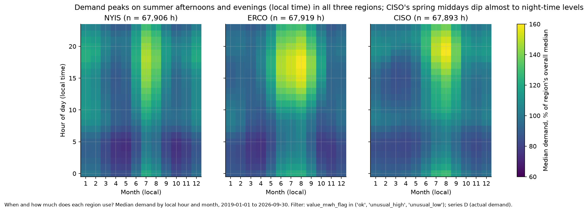
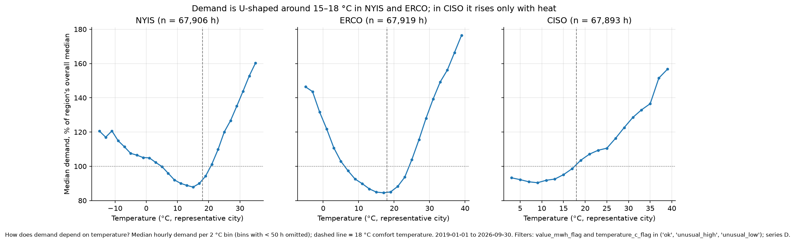

# Exploratory Analysis — Electricity Demand & Weather Pipeline

Milestone M4 · Notebook: [`notebooks/m4_eda.ipynb`](../notebooks/m4_eda.ipynb) · Figures: [`figures/`](../figures/) ·
Helpers: [`src/explore.py`](../src/explore.py)

> **Who writes what** (delete this box before the final commit). Edit only your own sections, in this order:
> Tuba (§3, §4 shape part, §7) → İrem (§5, §6) → Esma (§1, §2, §4 coverage part, §8 lists, §9).
> `git pull` before you start and again before you push. Add your own rows to the findings table in §8.

## 1. Summary

_(Esma — 5–6 sentences: the question, the answer as far as exploration can give it, how sure we are, the main thing
that could change it. M3 issues fixed since the m3 tag: none / list.)_

## 2. Raw versus cleaned

EIA's day-ahead forecast error (MAPE of DF against actual demand D, UTC hours) computed twice
(notebook 2.1, figure `f6_raw_vs_clean_mape.png`):

| Region | Raw M2 tables: hours | Raw MAPE | Cleaned layer: hours | Cleaned MAPE | Change |
|---|---|---|---|---|---|
| NYIS | 67,810 | 2.92 % | 67,626 | 2.66 % | −0.26 pts |
| ERCO | 67,799 | 2.43 % | 67,799 | 2.43 % | 0.00 pts |
| CISO | 67,776 | 8.61 % | 67,773 | 5.13 % | −3.48 pts |

*Raw* = the M2 tables as loaded, every hour where both values exist and actual demand is not zero.
*Cleaned* = `demand_clean`, both values kept by cleaning (flags `ok`, `unusual_high`, `unusual_low`,
`forecast_mismatch`).

Cleaning changes the key number most in CISO, and the whole change comes from **three hours**: the raw and
cleaned counts differ by exactly 3, the near-zero actual values of 2019-12-20 (14, 91 and 96 MWh, M3 issue I-06).
Against forecasts of about 24,000 MWh their percentage errors run to tens of thousands of percent, so three hours out
of 67,776 lift the mean by 3.5 points. In NYIS the 184 hours with a forecast published as 0 (M3 I-05) each count as a
100 % error in the raw tables (184 × 100 % / 67,810 ≈ 0.27 points). ERCO has no flagged values, so nothing changes. The
raw ranking (CISO far behind) is mostly an artefact; after cleaning, CISO's forecast is still the least accurate of the
three, but by about 2.5 points, not 6.

## 3. The question and its summary
**Question.** How large is EIA's own day-ahead forecast error in each region, i.e. the number our M7 model has to beat?

**Summary and why.** The key number is the MAPE of DF against D over trusted UTC hours (both values kept by cleaning,
D > 0), per region (notebook 2.2). MAPE answers "how wrong is the forecast in a typical hour, as a share of demand". It
is scale-free, so regions of very different size can be compared (mean hourly demand: NYIS ≈ 17,300 MWh, CISO ≈ 25,300
MWh, ERCO ≈ 49,700 MWh), and it is the metric M7 will report. Because the error distribution is heavy-tailed (§4.1), two
alternatives sit next to it: the **median** absolute percentage error (the typical hour, insensitive to the tail) and the
**95th percentile** of the absolute percentage error (how bad the bad hours are).

| Region | Hours (n) | MAPE | Median APE | P95 APE | Rank by MAPE | Rank by median | Rank by P95 |
|---|---|---|---|---|---|---|---|
| NYIS | 67,626 | 2.66 % | 2.42 % | 5.88 % | 2 | 2 | 1 |
| ERCO | 67,799 | 2.43 % | 1.78 % | 6.75 % | 1 | 1 | 2 |
| CISO | 67,773 | 5.13 % | 3.04 % | 19.42 % | 3 | 3 | 3 |
| All | 203,198 | 3.41 % | 2.32 % | 9.97 % | – | – | – |

Hours without a trusted D–DF pair are left out: 294 in NYIS, 121 in ERCO and 147 in CISO, out of 67,920 possible hours
each.

**Does the summary change the ranking?** CISO is last under every summary, so "CISO's forecast is the least accurate"
does not depend on the choice. The order of NYIS and ERCO does. ERCO is best on the typical hour (MAPE 2.43 % vs 2.66 %,
median 1.78 % vs 2.42 %), but NYIS is best on the bad hours (P95 5.88 % vs 6.75 %). The summaries answer different
questions: ERCO's forecast is usually closer, NYIS's rarely misses badly. CISO has the widest gap between mean and median
(5.13 % vs 3.04 %): a minority of very poor hours carries much of its MAPE, and its P95 is about three times the other
two regions'. We keep MAPE as the key number because it is what M7 must beat, and report the median and P95 beside it so
the tail stays visible.
## 4. What the data is made of

### 4.1 Shape

**Forecast error.** The signed error (DF − D) / D in percent, for the same 203,198 trusted hours as §3 (notebook 2.3,
figure `f1_df_error_distribution.png`). Bin width: three widths were tried on all hours (4 %, 1 % and 0.25 %). At 4 %
the peak collapses into two bars and the asymmetry disappears; at 1 % the peak is still blurred. We use **0.25 %**: with
about 68,000 hours per region every bin is well filled, and the shape of the peak stays visible. The histogram shows
−30 % to +30 %; 607 hours (0.30 %) fall outside and are hidden there but kept in the ECDF and in every number.

| Region | Skewness | Excess kurtosis | Hours outside ±30 % |
|---|---|---|---|
| NYIS | 0.52 | 2.85 | 0.00 % |
| ERCO | 2.66 | 32.22 | 0.08 % |
| CISO | −0.67 | 8.61 | 0.82 % |
| All | −0.70 | – | 0.30 % |

The three regions have different shapes, so the pooled shape is misleading. **NYIS** is narrow and has almost no tail,
but its peak sits slightly below zero: the forecast is systematically a little too low, a bias rather than noise.
**ERCO** is sharply peaked at zero with a very heavy right tail (kurtosis 32): nearly every hour is close, and a few
hours are large over-forecasts. **CISO** is the widest and has a long left tail: its bad hours are large
under-forecasts. The pooled skewness (−0.70) takes its sign from CISO alone; the other two regions lean the other way.
The ECDF of the absolute error (bottom row of `f1`) shows the same thing as the P95 in §3: NYIS and ERCO reach 95 % of
hours below about 6–7 % error, CISO only near 19 %.

**Demand.** Hourly demand D for the same hours (figure `f7_demand_distribution.png`, 500 MWh bins) is right-skewed in
every region: the mean is above the median (NYIS 17,300 vs 16,856 MWh; ERCO 49,747 vs 47,305 MWh; CISO 25,328 vs
24,394 MWh) and a long tail of peak hours reaches 31,857, 91,075 and 51,104 MWh. ERCO's distribution is by far the
widest (standard deviation 11,750 MWh against 3,153 in NYIS and 4,822 in CISO).

**What this means for §3.** Heavy tails mean that a few hours can move the mean error, which is why the median and P95
are reported beside the MAPE, and why the two summaries rank NYIS and ERCO differently. The NYIS bias also matters for
M7: part of EIA's error there is a constant offset that even a simple model could remove, so beating the MAPE in NYIS
says less than beating it in CISO.

### 4.2 Coverage, coverage rules and the flag filter

**Coverage.** Share of possible UTC hours with a trusted D–DF pair, per region and year (notebook 2.4; possible
hours: 8,760, or 8,784 in leap years and 6,552 for 2026 up to 30 September):

| Region | 2019 | 2020 | 2021 | 2022 | 2023 | 2024 | 2025 | 2026 |
|---|---|---|---|---|---|---|---|---|
| NYIS | 99.20 | 100.00 | 99.98 | 100.00 | 100.00 | 99.44 | 99.45 | 98.09 |
| ERCO | 100.00 | 100.00 | 99.99 | 100.00 | 100.00 | 100.00 | 99.45 | 98.90 |
| CISO | 99.85 | 99.97 | 99.93 | 99.97 | 99.98 | 99.44 | 99.45 | 99.65 |

Coverage is high everywhere, but the monthly view (figure `f2_forecast_coverage.png`) shows where it is thin: the
lowest month is 96.6 % in 2019–2023 and 93.2 % in 2024–2026 (CISO, November 2024). The gaps are whole days — days
with no published forecast (M3 I-03, I-E01) and NYIS forecast-zero days (I-05) — so recent years contribute fewer
comparable hours, and a monthly average for an affected month rests on one to three fewer days.

**Coverage rule.** A daily aggregate counts only with at least `DAILY_MIN_HOURS = 20` trusted hours. Twenty keeps the
23- and 25-hour DST days and days missing a single hour, but drops days where most hours are absent. A monthly
aggregate needs `MONTHLY_MIN_DAYS = 25` complete days. With and without the daily rule, the mean daily MAPE is:
NYIS 2.657 % (2,830 days) vs 2.658 % (2,805 days kept); ERCO 2.427 % vs 2.430 % (2,821 of 2,829); CISO 5.130 % vs
5.122 % (2,821 of 2,829). The rule changes almost nothing *because* the gaps are whole days: a day is either complete
or absent, rarely half-filled. We keep the rule so that a future partial day cannot slip into a daily average.

**Flag filter.** The key number under two filters: our main filter (every value cleaning kept, including real
extremes flagged `unusual_*`) and `ok` only:

| Region | Main filter: hours | MAPE | `ok` only: hours | MAPE | Change |
|---|---|---|---|---|---|
| NYIS | 67,626 | 2.658 % | 66,674 | 2.657 % | −0.001 pts |
| ERCO | 67,799 | 2.429 % | 67,533 | 2.432 % | +0.004 pts |
| CISO | 67,773 | 5.129 % | 65,602 | 5.154 % | +0.025 pts |

Dropping the flagged extremes removes up to 2,171 hours (CISO, mostly summer peaks) but moves the MAPE by at most
0.03 points, and in CISO it *raises* it: EIA forecasts the extreme-demand hours no worse than ordinary hours. We report
the main filter, because M3 established that the `unusual_*` values are real events, and leaving out the hottest hours
would bias any temperature analysis.

## 5. Time

_(İrem — the clock and why; edges; patterns at two time scales; calendar / holidays.)_

*Explored by İrem Çakmak (notebook section 2.5).* The question is about human behaviour, so hours are converted from UTC to each region's local time (`America/New_York`, `America/Chicago`, `America/Los_Angeles`) with `tz_convert`, which handles daylight saving time.

**Peak hour depends on the clock and on the flag filter** (median demand per hour, series D):

| Region | Filter | n (h) | Peak hour, UTC | Peak hour, local | Lowest hour, local |
|---|---|---|---|---|---|
| NYIS | `ok` | 67,167 | 00 | 19 | 04 |
| NYIS | `ok` + unusual | 67,906 | 23 | 19 | 04 |
| ERCO | `ok` | 67,674 | 23 | 18 | 04 |
| ERCO | `ok` + unusual | 67,919 | 23 | 17 | 04 |
| CISO | `ok` | 66,218 | 03 | 20 | 05 |
| CISO | `ok` + unusual | 67,893 | 03 | 19 | 05 |

Grouped by UTC hour, demand would seem to peak around midnight; in local time it peaks in the early evening. Excluding the `unusual_high` hours moves the peak one hour later in ERCO and CISO, because those hours are the summer afternoon peaks.

**Edges.** Because the period starts and ends at UTC midnight, the first and last local days are partial (NYIS 5 h and 20 h, ERCO 6 h and 19 h, CISO 8 h and 17 h). DST produces 23- and 25-hour local days; their counts do not match the number of transitions, which reveals a few hours missing from the source (see *Back to cleaning*).

**Two time scales.**  All regions peak on summer afternoons and evenings. NYIS also has a smaller winter-evening peak (heating). CISO's spring middays (Mar–May, 10:00–15:00) fall almost to night-time levels, which we infer is rooftop solar reducing grid demand (not confirmed).

**Calendar.** Daily mean demand on a holiday vs the median of the same weekday in the same month and year (days with ≥ 20 hours):

| Region | Independence Day | Thanksgiving | Christmas |
|---|---|---|---|
| NYIS | −10.2 % (−22.5…+21.4, n = 8) | −6.5 % (−9.6…−1.9, n = 7) | −7.9 % (−13.7…+8.8, n = 7) |
| ERCO | −7.6 % (−11.5…+15.3, n = 8) | −3.5 % (−13.1…−2.1, n = 7) | −5.9 % (−21.5…+27.8, n = 7) |
| CISO | −12.8 % (−23.7…−7.3, n = 8) | −7.7 % (−12.6…−3.2, n = 7) | −11.8 % (−15.2…−3.3, n = 7) |

Holidays lower demand everywhere, but weather can override them. The positive outliers are ERCO Christmas 2022 (+27.8 %) and NYIS Christmas 2022 (+8.8 %), during Winter Storm Elliott; NYIS 4 July 2026 (+21.4 %), during the heat wave that brought NYIS's highest temperature in our data (40.7 °C on 2 July 2026); and ERCO 4 July 2024 (+15.3 %), which we infer is a low baseline: the comparison Thursdays followed Hurricane Beryl's outages in Houston (from 8 July 2024). Each comparison uses only 3–4 days, so single values are fragile.

## 6. Relationships

_(İrem — binned medians / scatter first; Pearson and Spearman and which describes the picture better; what drives it;
what is left when it is removed; within-period comparison.)_

*Explored by İrem Çakmak (notebook section 2.6).* Question: how does hourly demand (series D) depend on the temperature of each region's representative city? Filters: `value_mwh_flag` and `temperature_c_flag` in `('ok', 'unusual_high', 'unusual_low')`; demand and weather joined on region and UTC hour through `map_region_location`.

**Shape first.**  Median demand per 2 °C bin (bins with fewer than 50 hours omitted). NYIS and ERCO are clearly U-shaped: demand is lowest at about 15 °C (NYIS, 88 % of its median) and 17–18 °C (ERCO, 85 %), rises to 160 % (NYIS) and 175 % (ERCO) in the heat and to 120 % and 145 % in the cold. CISO's cold side is flat (mild winters, little heating) and demand rises only above ≈ 15 °C, to about 155 % at 39 °C.

**Then coefficients.** Because the relationship is not monotonic, we split at 18 °C (the usual comfort temperature):

| Region | n (h) | Pearson, all | Spearman, all | Spearman ≥ 18 °C | Spearman < 18 °C |
|---|---|---|---|---|---|
| NYIS | 67,906 | 0.30 | 0.23 | 0.71 | −0.49 |
| ERCO | 67,919 | 0.54 | 0.64 | 0.80 | −0.43 |
| CISO | 67,893 | 0.54 | 0.49 | 0.34 | 0.20 |

One coefficient per region is misleading: NYIS's 0.23 hides a strong cooling effect and a strong heating effect that cancel out.

**Driver check.** Is the relationship carried by a few events, or confounded by time of day?

| Region | Check | Spearman ≥ 18 °C (n) | Spearman < 18 °C (n) |
|---|---|---|---|
| NYIS | baseline | 0.71 (24,388) | −0.49 (43,518) |
| NYIS | without unusual temperature hours | 0.71 (24,388) | −0.49 (43,518) |
| NYIS | only 17:00 local | 0.78 (1,302) | −0.81 (1,527) |
| ERCO | baseline | 0.80 (48,926) | −0.43 (18,993) |
| ERCO | without unusual temperature hours | 0.80 (48,926) | −0.41 (18,714) |
| ERCO | without Uri (10–20 Feb 2021) | 0.80 (48,919) | −0.42 (18,736) |
| ERCO | only 17:00 local | 0.88 (2,315) | −0.43 (515) |
| CISO | baseline | 0.34 (31,285) | 0.20 (36,608) |
| CISO | only 17:00 local | 0.77 (1,997) | −0.15 (832) |

Removing extreme temperature hours or the Uri week barely moves the coefficients, so no single event drives them (the plan expected Uri might dominate ERCO; it does not). Fixing the hour, however, makes them clearly stronger, and CISO's cold-side sign flips: cold hours are mostly night hours, when demand is low anyway. Time of day is a confounder, and any model should include it together with temperature. We did not repeat the check within single months; that and all 24 hours remain to be done (§9).

## 7. The comparison

**Question.** Is EIA's day-ahead forecast worse on the hottest summer days? This is the comparison closest to the
project question: if hot days carry extra error, weather has information the forecast does not use.

**Set-up** (notebook 2.7, figure `f5_hot_day_comparison.png`).
- **Unit: the day, not the hour.** Hours inside a day are strongly correlated, so an hourly bootstrap would give an
  artificially narrow interval. Each region's hours are grouped into local calendar days (`LOCAL_TZ`); a day counts only
  with at least `DAILY_MIN_HOURS = 20` trusted hours (§4.2). The outcome is the day's MAPE.
- **Temperature:** the region's hourly temperature is the mean over its mapped cities; a day's value is the maximum.
- **Hot day:** a day in the top 10 % of daily maximum temperature *within June–September* for that region (threshold
  about 32.7 °C in NYIS, 36.4 °C in ERCO, 35.1 °C in CISO). Only June–September days are used, so winter days, which
  have different errors for other reasons, cannot enter the "other days" group.
- **Interval:** percentile bootstrap, `N_BOOT = 2000` resamples, `SEED = 42`, resampling days within each
  (hot / other × month) cell.

**Composition check.** Even inside June–September, hot days are not spread like other days: 50 % of NYIS hot days fall
in July, 47 % of ERCO's in August and 78 % of CISO's in August–September, while other days are spread about evenly over
the four months. A raw difference could therefore be a month effect (Simpson's paradox). We report a second,
**month-adjusted** difference: hot days are compared only with other days of the same month, and the monthly
differences are weighted by the hot days' month mix.

| Region | Hot / other days | Mean daily MAPE, hot vs other | Raw difference (95 % CI) | Month-adjusted difference (95 % CI) |
|---|---|---|---|---|
| NYIS | 98 / 873 | 2.80 % vs 2.38 % | +0.41 pts (+0.16, +0.70) | +0.37 pts (+0.11, +0.65) |
| ERCO | 106 / 866 | 1.71 % vs 2.15 % | −0.44 pts (−0.62, −0.23) | −0.40 pts (−0.59, −0.20) |
| CISO | 99 / 876 | 4.81 % vs 4.83 % | −0.02 pts (−0.49, +0.47) | +0.11 pts (−0.37, +0.62) |

**Result.** The answer depends on the region. In **NYIS** the forecast is worse on hot days by about 0.4 points, and the
interval excludes zero with or without the month adjustment. In **ERCO** it is *better* on hot days by about 0.4 points,
again with or without the adjustment; the Texas forecast seems tuned for heat. In **CISO** the interval is wide and
includes zero under both versions: no evidence either way. The month adjustment moves every estimate by less than 0.15
points, so the month mix is not what drives the NYIS and ERCO results.

**How many comparisons.** We looked at one comparison (hot vs other summer days), run in three regions, so three
intervals. We did not try other temperature thresholds, seasons or periods before choosing this one. With three 95 %
intervals the chance that at least one excludes zero by luck alone is about 14 %, so each result is *exploratory*.

**Limits.** Hot days come in runs (heat waves), so days next to each other are not independent and the intervals are
probably somewhat too narrow; a block bootstrap by week would be more honest. The 10 % threshold is a choice; a
different cut-off could change the size of the effect, though probably not its sign in NYIS and ERCO.

## 8. Findings

Every member adds at least two rows. Label: *exploratory* (seen in this data, not yet tested elsewhere) or
*confirmed* (holds by construction or arithmetic, or tested on held-out data).

| ID | Finding | Evidence | Label | What would change it | Explored by |
|---|---|---|---|---|---|
| F-01 | The summary decides the NYIS–ERCO order: ERCO has the lowest MAPE (2.43 %) and median APE (1.78 %), NYIS the lowest P95 (5.88 % vs 6.75 %); CISO is last under all three. | Notebook 2.2; §3 table | confirmed | A different period (e.g. 2024–2026 only) or flag filter could reorder NYIS and ERCO; CISO's last place is robust. | Tuba |
| F-02 | Forecast-error shape differs by region: NYIS has a small systematic under-forecast, ERCO rare large over-forecasts (kurtosis 32), CISO a long under-forecast tail (0.82 % of hours beyond ±30 %). | `f1_df_error_distribution.png`; notebook 2.3 | exploratory | Splitting by year: a change in EIA's forecasting method could remove the NYIS bias or the CISO tail. | Tuba |
| F-03 | On the hottest 10 % of summer days, DF error is higher in NYIS (+0.37 pts, 95 % CI +0.11 to +0.65) and lower in ERCO (−0.40 pts, −0.59 to −0.20); CISO shows no clear effect. | `f5_hot_day_comparison.png`; notebook 2.7 | exploratory | A block bootstrap by week (heat-wave days are not independent), another hot-day threshold, or held-out years. | Tuba |
| F-04 | The daily peak is at 17:00–20:00 local time in all three regions; grouped by UTC hour it appears at 23:00–03:00, a 5–7 hour shift. | Notebook 2.5 peak-hour table; `fig3_hour_by_month_local.png` | confirmed | Nothing in the data; it follows from the time-zone offset (DST handled by `tz_convert`). | İrem |
| F-05 | The `ok`-only filter moves the peak one hour later in CISO (19:00 → 20:00) and ERCO (17:00 → 18:00), because it drops the `unusual_high` hours, which are the summer peaks. | Notebook 2.5 peak-hour table, both filters | exploratory | A seasonal split: the shift should appear only in summer months. | İrem |
| F-06 | CISO's spring middays (Mar–May, 10:00–15:00 local) drop almost to night-time demand. Inferred cause: behind-the-meter rooftop solar reduces grid demand. | `fig3_hour_by_month_local.png` | exploratory | Solar generation data for CAISO; the dip should grow year by year as solar capacity grows. | İrem |
| F-07 | Holidays lower demand (median −3.5 % to −12.8 % vs the same weekday in the same month), but weather can reverse it: ERCO Christmas 2022 +27.8 % (Winter Storm Elliott), NYIS 4 July 2026 +21.4 % (heat wave). | Notebook 2.5 holiday tables | exploratory | Only 7–8 holidays per type and 3–4 comparison days each; a weather-adjusted baseline could change the sizes. | İrem |
| F-08 | Demand is U-shaped in temperature, so one correlation hides it: NYIS Spearman 0.23 overall, but +0.71 above 18 °C and −0.49 below. Removing unusual temperature hours or the Uri week changes the coefficients by at most 0.02. | `fig4_temperature_vs_demand.png`; notebook 2.6 tables | confirmed | Weather from more cities per region; the U should stay, its minimum may move. | İrem |
| F-09 | Time of day masks the temperature effect: at a fixed hour (17:00) the warm-side Spearman rises to 0.77–0.88 and NYIS's cold side to −0.81; CISO's cold-side sign flips from +0.20 to −0.15 (cold hours are mostly night hours). | Notebook 2.6 driver-check table | exploratory | Repeating for all 24 hours and within single months; n at 17:00 is small (CISO cold side 832 h). | İrem |

### Back to cleaning

_(Anything exploration showed the cleaned layer got wrong or missed — also added to `docs/cleaning_report.md` and fixed in
`src/clean.py`. "None found" is fine if true.)_

- **Hours absent from the source around DST changes** (İrem): counting rows per *local* day, NYIS and ERCO each have only 6 autumn-transition days with 25 hours (7 expected for 2019–2025) and CISO has 10 instead of 8 days with 23 hours. These hours are not NULL values but missing rows, so M3's missing-value counts do not see them; a coverage check on expected hours per local day would.
- **Edge days pass the daily rule** (İrem): the first and last local days are partial because the period starts and ends at UTC midnight (NYIS 5 h and 20 h, ERCO 6 h and 19 h, CISO 8 h and 17 h). `DAILY_MIN_HOURS = 20` still admits NYIS's last day (30 Sep 2026, 20 h); edge days should be excluded explicitly.
- **Representative weather point for CISO** (İrem): the weak cold-side and modest warm-side response in CISO is consistent with M3's I-W05/I-W06 note that coastal Los Angeles is an approximation for all of California.

### Forward to modelling

_(Questions M7 should answer; what M7 must be careful about: thin periods, leakage, seasonality, variables that only exist
after the outcome.)_

- **Time features in local time** (İrem): local hour, weekday, month and a holiday indicator, computed with `tz_convert`; grouping by UTC hour shifts the daily peak by 5–7 hours (§5).
- **Temperature as two effects, not one** (İrem): demand falls with temperature below ≈ 15–18 °C and rises above it (§6), so a single linear temperature term would cancel out. Use heating and cooling degrees (or a piecewise term) per region, with an hour × temperature interaction: at a fixed hour the relationship is much stronger (§6, driver check).
- **Extreme events as stress tests** (İrem): Winter Storm Uri (Feb 2021), Winter Storm Elliott (Dec 2022), Hurricane Beryl (Jul 2024) and the NYIS heat wave of early July 2026 should be kept and reported separately in evaluation, not averaged away.
- **CISO weather input** (İrem): one coastal city captures heat response only partly; an inland city or a solar proxy may help CISO more than any model choice.

## 9. What we can't say

_(Esma, with input from Tuba and İrem — limits of the data, thin groups, exploratory findings.)_
